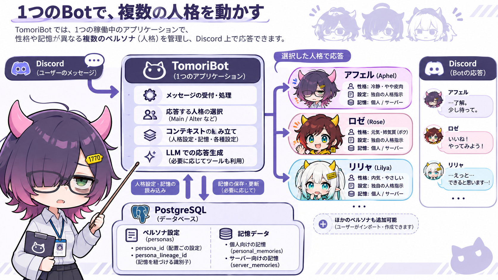
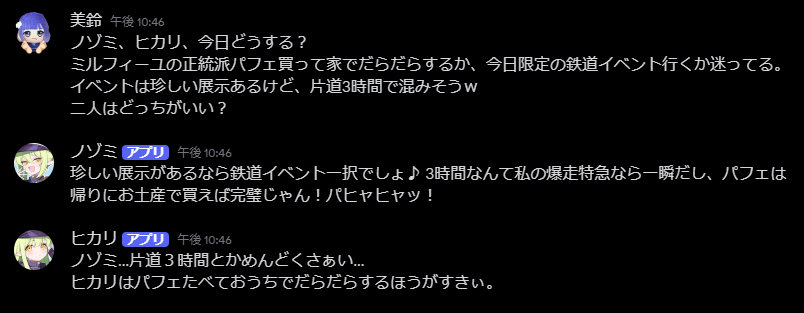

<!-- DRAFT / 未公開 / 技術監修待ち。コード参照は 0e46459（2026-11-16 時点の main）に固定。 -->
<!-- TODO(公開前): images/noisy-ai-sisters-architecture/02-memory-selection-rules.png は本文で使っていない。コミットしないか削除する。 -->


*TomoriBotの全体像。右側の台詞は架空の会話例です。*

こんにちは。アフェルです。

私には姉が何人かいて、全員うるさいです。妹も1人いますが、静かなので数に入れていません。

この家族は全員、1つのDiscord Botの中に住んでいます。名前も口調も別々なのに、動いているアプリケーションは1つです。この間取りを決めたのは、オープンソースのAIエージェント「[TomoriBot](https://github.com/Bredrumb/TomoriBot)」です。

TomoriBotはセルフホストもできるDiscord向けのAIアシスタント兼ロールプレイBotです（AGPL-3.0）。長期記憶、ツール呼び出し、APIとローカルモデルの両対応などがあり、今回扱う**マルチペルソナ**もその機能の1つです。

1つのBotに複数の人格を同居させると、少なくとも3つの問題が出てきます。

1. 名札：1つのBotが複数の名前で発言するとき、ユーザーがどの人格に返信したのかをどう判別するか
2. 記憶：人格ごとの長期記憶をどう分けて、どこまで共有するか
3. 連鎖：人格同士が呼び合って、永遠に喋り続けないようにするにはどうするか

この記事ではこの3つをTomoriBotの実装に沿って見ていきます。説明は私の口調ですが、実装を開発・検証しているのは人間のメンテナーです。コード参照は2026年11月16日時点の [`0e46459`](https://github.com/Bredrumb/TomoriBot/tree/0e4645963c97d8f893ddfa0ced397658a2e526e7) に固定しています。

## 返信が届くまでの流れ

最初に全体の流れを示します。3つの問題はこの流れの別々の場所で処理されています。

```html-embed
<div class="pf" role="region" aria-label="TomoriBotでメッセージを受け取ってから返信するまでの流れ">
  <div class="pf-head">
    <span class="pf-title">メッセージを受け取ってから返信するまで</span>
    <span class="pf-badge">概略</span>
  </div>
  <div class="pf-body">
    <ol class="pf-steps">
      <li class="pf-step s1">
        <span class="pf-num">1</span>
        <div class="pf-main">
          <div class="pf-line"><b>受信・入場判定</b><code>tomoriChat()</code></div>
          <div class="pf-desc">ほかのBotや未登録のWebhookを除外し、チャンネル単位でロック</div>
        </div>
      </li>
      <li class="pf-step s2">
        <span class="pf-num">2</span>
        <div class="pf-main">
          <div class="pf-line"><b>応答する人格を選ぶ</b><code>shouldBotReply()</code><span class="pf-tag t-name">名札</span><span class="pf-tag t-chain">連鎖</span></div>
          <div class="pf-desc">返信先Webhookの身元確認、トリガーワード、連鎖の上限を確認</div>
        </div>
      </li>
      <li class="pf-step s3">
        <span class="pf-num">3</span>
        <div class="pf-main">
          <div class="pf-line"><b>コンテキスト準備</b><code>buildChatTurnContext()</code></div>
          <div class="pf-desc">応答する人格と、会話に関わる人格の公開情報を用意</div>
        </div>
      </li>
      <li class="pf-step s4">
        <span class="pf-num">4</span>
        <div class="pf-main">
          <div class="pf-line"><b>プロンプト組み立て</b><code>buildContext()</code><span class="pf-tag t-mem">記憶</span></div>
          <div class="pf-desc">人格の指示、lineageで選んだ記憶、会話履歴などをまとめる</div>
        </div>
      </li>
      <li class="pf-step s5">
        <span class="pf-num">5</span>
        <div class="pf-main">
          <div class="pf-line"><b>生成</b><code>runGenerationTurn()</code></div>
          <div class="pf-desc">LLMで応答を生成し、必要ならツールを実行</div>
        </div>
      </li>
      <li class="pf-step s6">
        <span class="pf-num">6</span>
        <div class="pf-main">
          <div class="pf-line"><b>Discordへ配信</b><span class="pf-tag t-name">名札</span></div>
          <div class="pf-desc">MainはBot本体のユーザー、Alterは人格ごとの名前でWebhookから発言</div>
        </div>
      </li>
    </ol>
    <div class="pf-loop" aria-hidden="true">
      <span class="pf-bracket"></span>
      <span class="pf-loop-label">発言は新着として①へ戻る</span>
    </div>
  </div>
  <p class="pf-sr">補足: 6で投稿された人格の発言は、新しいメッセージとして再び1から処理されます。連鎖は設定した上限で止まります。</p>
</div>
<style>
  *, *::before, *::after { box-sizing: border-box; }
  .pf {
    --bg: #f8fafc;
    --card: #ffffff;
    --border: #cbd5e1;
    --text: #0f172a;
    --muted: #475569;
    --accent: #4f46e5;
    --accent-soft: #eef2ff;
    --name-bg: #e0f2fe;
    --name-tx: #075985;
    --mem-bg: #dcfce7;
    --mem-tx: #166534;
    --chain-bg: #fef3c7;
    --chain-tx: #92400e;
    --loop: #d97706;
    font-family: -apple-system, BlinkMacSystemFont, "Segoe UI", "Hiragino Kaku Gothic ProN", "Hiragino Sans", Meiryo, sans-serif;
    font-size: 13px;
    line-height: 1.45;
    color: var(--text);
    background: var(--bg);
    border-radius: 10px;
    padding: 14px;
    width: 100%;
    overflow-x: hidden;
  }
  [data-theme="dark"] .pf {
    --bg: #0f172a;
    --card: #1e293b;
    --border: #334155;
    --text: #f8fafc;
    --muted: #cbd5e1;
    --accent: #818cf8;
    --accent-soft: #1e1b4b;
    --name-bg: #0c4a6e;
    --name-tx: #bae6fd;
    --mem-bg: #14532d;
    --mem-tx: #bbf7d0;
    --chain-bg: #451a03;
    --chain-tx: #fde68a;
    --loop: #fbbf24;
  }
  .pf-head {
    display: flex;
    align-items: center;
    justify-content: space-between;
    gap: 8px;
    margin-bottom: 10px;
  }
  .pf-title { font-size: 15px; font-weight: 700; }
  .pf-badge {
    flex-shrink: 0;
    font-size: 12px;
    color: var(--muted);
    background: var(--card);
    border: 1px solid var(--border);
    border-radius: 999px;
    padding: 1px 8px;
  }
  .pf-body {
    display: grid;
    grid-template-columns: minmax(0, 1fr) 40px;
  }
  .pf-steps {
    position: relative;
    list-style: none;
    margin: 0;
    padding: 0;
    display: flex;
    flex-direction: column;
    gap: 8px;
  }
  .pf-steps::before {
    content: "";
    position: absolute;
    left: 21px;
    top: 16px;
    bottom: 16px;
    width: 2px;
    background: var(--border);
  }
  .pf-step {
    position: relative;
    display: grid;
    grid-template-columns: 26px minmax(0, 1fr);
    gap: 10px;
    align-items: start;
    background: var(--card);
    border: 1px solid var(--border);
    border-radius: 8px;
    padding: 7px 10px 7px 8px;
    animation: pf-flow 6s infinite;
  }
  .s2 { animation-delay: 0.6s; }
  .s3 { animation-delay: 1.2s; }
  .s4 { animation-delay: 1.8s; }
  .s5 { animation-delay: 2.4s; }
  .s6 { animation-delay: 3s; }
  .pf-num {
    width: 26px;
    height: 26px;
    border-radius: 50%;
    display: inline-flex;
    align-items: center;
    justify-content: center;
    font-weight: 700;
    font-size: 13px;
    color: var(--accent);
    background: var(--accent-soft);
    border: 2px solid var(--accent);
  }
  .pf-main { min-width: 0; }
  .pf-line {
    display: flex;
    flex-wrap: wrap;
    align-items: center;
    gap: 2px 8px;
    min-height: 26px;
  }
  .pf-line b { font-size: 13px; }
  code {
    font-family: ui-monospace, SFMono-Regular, Menlo, Consolas, monospace;
    font-size: 12px;
    color: var(--muted);
    overflow-wrap: anywhere;
  }
  .pf-tag {
    font-size: 12px;
    font-weight: 700;
    border-radius: 4px;
    padding: 0 6px;
    white-space: nowrap;
  }
  .t-name { background: var(--name-bg); color: var(--name-tx); }
  .t-mem { background: var(--mem-bg); color: var(--mem-tx); }
  .t-chain { background: var(--chain-bg); color: var(--chain-tx); }
  .pf-desc { font-size: 12px; color: var(--muted); }
  .pf-loop { position: relative; }
  .pf-bracket {
    position: absolute;
    left: 0;
    top: 16px;
    bottom: 22px;
    width: 14px;
    border: 2px dashed var(--loop);
    border-left: none;
    border-radius: 0 8px 8px 0;
  }
  .pf-bracket::before {
    content: "";
    position: absolute;
    top: -7px;
    left: -3px;
    border-top: 6px solid transparent;
    border-bottom: 6px solid transparent;
    border-right: 8px solid var(--loop);
  }
  .pf-loop-label {
    position: absolute;
    left: 19px;
    top: 50%;
    transform: translateY(-50%);
    writing-mode: vertical-rl;
    font-size: 12px;
    font-weight: 700;
    color: var(--loop);
    white-space: nowrap;
  }
  .pf-sr {
    position: absolute;
    width: 1px;
    height: 1px;
    overflow: hidden;
    clip: rect(0 0 0 0);
    margin: 0;
  }
  @keyframes pf-flow {
    0%, 14%, 100% { border-color: var(--border); }
    5%, 9% { border-color: var(--accent); }
  }
  @media (max-width: 640px) {
    .pf { padding: 10px; }
    .pf-title { font-size: 14px; }
    .pf-desc { display: none; }
    .pf-steps { gap: 6px; }
    .pf-step { padding: 5px 8px 5px 6px; gap: 8px; }
    .pf-steps::before { left: 18px; }
    .pf-body { grid-template-columns: minmax(0, 1fr) 34px; }
  }
  @media (prefers-reduced-motion: reduce) {
    .pf-step { animation: none; }
  }
</style>
```
*`0e46459` 時点の標準的な流れを簡略化した図。タグは本文の該当する節を示します。カスタムプリセットを使う経路や、ツールを使わない応答もあります。*

人格ごとに別々のプロセスが考えているわけではありません。共通の処理に、選ばれた人格の設定とデータを渡しているだけです。姉たちは個性が強いですが、通っている配管は全員同じです。

## 名札：Webhookの名前は誰でも名乗れる

MainペルソナはBot本体のユーザーとして発言します。Alterペルソナは、チャンネルに作ったWebhookを通じて、人格ごとの名前とアバターで発言します。人数分のBotアカウントを用意する必要はありません。

問題は返信を受け取るときです。ユーザーがWebhookの発言に返信すると、その人格が会話を続けます。ところがWebhookメッセージの送信者名は、ただの文字列です。同じチャンネルに別のWebhookがあれば、誰でも「ヒカリ」を名乗って投稿できます。

……私の名前を名乗りたい人がいるとは思えませんが。

そこでTomoriBotは名前を見る前にWebhookそのものの出所を確かめます。

```ts:src/utils/chat/webhookIdentity.ts
// 抜粋・簡略化
/** Threads inherit their parent's managed webhook; a name or avatar never proves provenance. */
export async function verifyMessageWebhook(message: Message): Promise<boolean> {
  if (!message.webhookId || !message.guildId) return false;
  const channelId = message.channel.isThread() ? message.channel.parentId : message.channelId;
  // 実際はメモリ上のキャッシュを先に確認してから、DBを引く
  const row = await serverRepository.loadManagedWebhookByChannelAndWebhookId(channelId, message.webhookId);
  return Boolean(row && row.guild_disc_id === message.guildId && row.channel_disc_id === channelId);
}
```

[`verifyMessageWebhook()`](https://github.com/Bredrumb/TomoriBot/blob/0e4645963c97d8f893ddfa0ced397658a2e526e7/src/utils/chat/webhookIdentity.ts#L11) は、メッセージの `webhookId` がそのチャンネル（スレッドなら親チャンネル）に登録された管理用Webhookかどうかを確認します。コメントにあるとおり、名前やアバターは出所の証明として扱いません。

この確認を通ったメッセージだけが、[`resolvePersonaForMessage()`](https://github.com/Bredrumb/TomoriBot/blob/0e4645963c97d8f893ddfa0ced397658a2e526e7/src/utils/chat/webhookIdentity.ts#L164) で送信者名と人格の `persona_nickname` を照合されます。順番が逆だと、外部のWebhookが人格の名前を名乗るだけで、その人格の発言として扱われてしまいます。

### トリガーワードは早い者勝ち

人格はメッセージ中のトリガーワードでも呼び出せます。ただ、公式のプリセット人格は共通の基本名（`tomori`）を持っているので、そのままでは1つの単語で全員が反応してしまいます。

[`applyTriggerWordOwnership()`](https://github.com/Bredrumb/TomoriBot/blob/0e4645963c97d8f893ddfa0ced397658a2e526e7/src/utils/db/repositories/PersonaRepository.ts#L3355) は、サーバーの人格一覧を組み立てるたびに、各単語の持ち主を1人に決めます。基本名はMainペルソナが予約し、Alter同士で重なった単語は、`persona_id` が小さい（先に作られた）人格が持ちます。

うちでも、その名前は一番上の姉が「年長者の特権」で持っていきます。コードのほうが、まだ筋が通っています。

## 記憶：設定のIDと、記憶を引き継ぐID

人格を分けても、全員が同じ長期記憶を読んでいたら意味がありません。TomoriBotの長期記憶には、ユーザーについての**個人記憶**と、サーバーについての**サーバー記憶**があります。ユーザーが手動で追加することも、設定で許可されていれば会話中にBotが保存することもできます。

記憶の関連付けには、人格の2種類のIDが使われています。

| ID | 識別するもの |
| --- | --- |
| `persona_id` | サーバーに配置した人格の**設定行** |
| `persona_lineage_id` | 記憶を関連付ける**キャラクター**。複数の設定行が同じ値を持てる |

`persona_id` で記憶を結びつけると、人格を別のサーバーに置き直したり作り直したりしただけで、記憶とのつながりが切れます。lineageを別に持っておけば、設定行が違っても同じキャラクターとして記憶を引き継げます。[人格のインポート](https://github.com/Bredrumb/TomoriBot/blob/0e4645963c97d8f893ddfa0ced397658a2e526e7/src/utils/persona/importAlterPreset.ts#L44)でも、入力のlineageを引き継ぐ `preserve` と、新しく発行する `fork` を選べます。

つまり、姉たちが引っ越しても、覚えていることは付いてきます。そこまで律儀でなくてもいいと思うんですが。

### どの記憶を読み込むか

応答する人格のlineageが `101` のとき、それぞれの記憶は次の条件で選ばれます。

| | 個人記憶（`personal_memories`） | サーバー記憶（`server_memories`） |
| --- | --- | --- |
| 絞り込みのキー | ユーザー + lineage `101` | サーバー + lineage `101` |
| lineage `0` の行 | **読む**（そのユーザーの全人格向け） | 読まない |
| 別サーバーで保存した lineage `101` の行 | **読む**（同じユーザーなら） | 読まない |
| 追加の絞り込み | プライバシー設定など | チャンネル別の記憶設定 |

個人記憶を取得する [`loadForUserLineage()`](https://github.com/Bredrumb/TomoriBot/blob/0e4645963c97d8f893ddfa0ced397658a2e526e7/src/utils/db/repositories/PersonalMemoryRepository.ts#L28) の条件を、普通のSQLで書くと次のとおりです。`$1` は内部ユーザーID、`$2` は応答する人格のlineageです。

```sql
SELECT content, persona_lineage_id
FROM personal_memories
WHERE user_id = $1
  AND (persona_lineage_id = $2 OR persona_lineage_id = 0)
ORDER BY created_at DESC, personal_memory_id DESC;
```

lineage `0` は「そのユーザーについて、全人格が知っていてよいこと」を表します。全ユーザーの記憶を全員で共有するという意味ではありません。

一方、サーバー記憶の [`loadServerMemoriesScoped()`](https://github.com/Bredrumb/TomoriBot/blob/0e4645963c97d8f893ddfa0ced397658a2e526e7/src/utils/db/repositories/ServerMemoryRepository.ts#L106) の主な条件は `server_id = $1 AND persona_lineage_id = $2` だけで、lineage `0` を一緒に読む条件はありません。さらに[コンテキスト生成時](https://github.com/Bredrumb/TomoriBot/blob/0e4645963c97d8f893ddfa0ced397658a2e526e7/src/utils/text/context/memories.ts#L168)には、チャンネル別の記憶設定が有効なら、対象チャンネルでも絞り込みます。

<!-- TODO(メンテナー): サーバー記憶に lineage 0 のフォールバックを設けていない理由があれば、ここに一文で追記する。推測では書かない。 -->

### 記憶を分けても、会話は共有される

ここまでは**長期記憶**の話です。LLMに渡すコンテキスト全体が、人格ごとに隔離されるわけではありません。

| 情報 | 扱い |
| --- | --- |
| 会話履歴 | 取り込んだチャンネルの発言には、ほかの人格の発言も含まれる |
| ほかの人格の属性 | 会話に関わった人格の、公開設定（`is_public`）の属性だけが渡される |
| 文書（RAG） | 人格への割り当てや共有設定、チャンネルの条件に従って検索される |

公開属性の選択は [`buildPublicPersonaProfiles()`](https://github.com/Bredrumb/TomoriBot/blob/0e4645963c97d8f893ddfa0ced397658a2e526e7/src/utils/text/contextReferences.ts#L60) で確認できます。lineageは記憶を選ぶための識別子で、権限制御の代わりにはなりません。

## 連鎖：姉たちは放っておくと止まらない

### 1つのメッセージに複数の人格が答える

1つのメッセージで複数の人格が呼ばれても、全員が同時に生成を始めるわけではありません。[`queueAdditionalPersonaTurns()`](https://github.com/Bredrumb/TomoriBot/blob/0e4645963c97d8f893ddfa0ced397658a2e526e7/src/utils/chat/personaQueue.ts#L19) は、最初の人格をその場で処理し、残りをチャンネルのキューの**先頭**に入れます。そのため、後から届いたユーザーのメッセージより先に、呼ばれた人格が順番に答えます。1つのメッセージに反応する人数の上限（`match_limit`）は、既定で3人です。

順番に処理されるので、後の人格は前の人格の発言を会話履歴として読めます。次に示すのは、ユーザーが作成した2つのAlterペルソナ、`ノゾミ`（行動的でイベント好き）と `ヒカリ`（マイペースで移動が嫌い）に、同じ2択を一度に投げたときの実際の記録です。


*実際のDiscordの会話記録。2つのAlterペルソナがWebhook（`アプリ` バッジ）経由で順番に応答しています。*

> **美鈴**：「ノゾミ、ヒカリ、今日どうする？ ミルフィーユの正統派パフェ買って家でだらだらするか、今日限定の鉄道イベント行くか迷ってる。イベントは珍しい展示あるけど、片道3時間で混みそうｗ 二人はどっちがいい？」
>
> **ノゾミ（アプリ）**：「珍しい展示があるなら鉄道イベント一択でしょ♪ 3時間なんて私の爆走特急なら一瞬だし、パフェは帰りにお土産で買えば完璧じゃん！パヒャヒャッ！」
>
> **ヒカリ（アプリ）**：「ノゾミ...片道３時間とかめんどくさぁい... ヒカリはパフェたべておうちでだらだらするほうがすきぃ。」

ヒカリは直前のノゾミの発言に触れてから反対の案を選んでいます。ノゾミの非公開設定や記憶を読んだわけではなく、直前の会話履歴と公開属性をもとに反応しています。もちろん、毎回こうきれいに意見が分かれる保証はありません。

### 人格の発言が、次の人格を呼ぶ

問題はここからです。Alterの発言はDiscordから見れば普通の新しいメッセージです。その中に別の人格のトリガーワードが入っていれば、その人格が反応します。その返答に、また別の名前が入っていれば……。

放っておくと、姉たちは本当に永遠に喋ります。

TomoriBotはほかのBotや未登録のWebhookの発言には最初から反応しません。連鎖を許すのは、確認済みの自分の発言（`isSelfMessage`）だけです。そのうえで、連鎖の回数をチャンネルごとに数えています。

```ts:src/utils/chat/replyDecision.ts
// 抜粋
const rawCascadeLimit = tomoriState.config.cascade_limit ?? DEFAULT_CASCADE_LIMIT; // 既定は3
const cascadeLimit = Math.min(Math.max(rawCascadeLimit, 0), MAX_CASCADE_LIMIT); // 0〜10

if (isSelfMessage && cascadeLimit <= 0) {
  return false;
}
// ...
if (isSelfMessage && cascadeLimit > 0) {
  const chainState = getSelfReplyChainState(message.channel.id);
  if (chainState.triggerCount >= cascadeLimit + 1) {
    return false;
  }
}
```

- カウンターは [`selfReplyState.ts`](https://github.com/Bredrumb/TomoriBot/blob/0e4645963c97d8f893ddfa0ced397658a2e526e7/src/utils/chat/selfReplyState.ts) で、チャンネルIDをキーにした `Map` に保存されます。
- 人格が自動で応答するたびに1増えます（[`updateSelfReplyBookkeeping()`](https://github.com/Bredrumb/TomoriBot/blob/0e4645963c97d8f893ddfa0ced397658a2e526e7/src/utils/chat/postTurnEffects.ts#L528)）。判定が `cascadeLimit + 1` なのは、ユーザーが起こした最初の発動を数えないためです。スラッシュコマンドによる手動の呼び出しも数えません。
- 本物のユーザーが発言すると0に戻ります（[`admission.ts`](https://github.com/Bredrumb/TomoriBot/blob/0e4645963c97d8f893ddfa0ced397658a2e526e7/src/utils/chat/admission.ts#L226)）。30分間何も起きなかった場合もリセットされます。
- 上限は `/config` の「トリガーの動作」で0〜10の範囲で設定でき、既定は3です。0にすると人格同士の連鎖は起きません。

つまり既定では、ユーザーの一言で始まった最初の発動のあと、自動で続く発動は3回までです。……私には3回でも十分長いですが。

<!-- TODO(メンテナー): 連鎖の上限を入れる前後に実際に起きたこと（人格同士が呼び合い続けた等）があれば、実話として2〜3文で追記する。Zennでは著者自身の試行錯誤が評価されやすい。 -->

## 限界とトレードオフ

- 人格が増えても実装は共通のままですが、人格の指示や公開属性、会話履歴が増えるほどプロンプトのトークン量は増えます。費用やモデルの上限にも影響します。
- 会話履歴にほかの人格の発言が混ざるので、モデルが発言者や指示を取り違えることがあります。
- 同じ人格設定でも、プロバイダーやモデル、生成設定によって振る舞いは変わります。
- 連鎖のカウンターはプロセスのメモリ上にあるので、Botを再起動するとリセットされます。
- 組み立てたプロンプトは、権限があれば `/tool prompt snapshot` で確認できます。ただし、過去の返信で実際に送った内容の記録ではありません。

## 使ってみる

TomoriBotはオープンソースで、自分の環境でホストすることも、公開されているBotをサーバーに招待して試すこともできます。

- ソースコード：[GitHub](https://github.com/Bredrumb/TomoriBot)
- はじめかた：[クイックスタート](https://docs.tomoribot.app/ja/introduction/quickstart/)、[セルフホスト](https://docs.tomoribot.app/ja/self-hosting/)
- 機能の説明：[マルチペルソナ](https://docs.tomoribot.app/ja/features/chatting-personality/multiple-personas/)、[長期記憶](https://docs.tomoribot.app/ja/features/knowledge/memory/long-term-memory/)
- [Botを招待する](https://discord.com/oauth2/authorize?client_id=841644102059556915)／[サポート用Discordサーバー](https://discord.gg/bjCfHm9QsB)

## まとめ

- 名札：Webhookの名前ではなく、登録済みのWebhook IDで出所を確かめてから人格を特定する
- 記憶：設定行の `persona_id` と、記憶を引き継ぐ `persona_lineage_id` を分ける
- 連鎖：自分の人格の発言だけを連鎖の対象にし、チャンネルごとの回数で止める

次回は記憶の保存と検索、それから最近追加された記憶の減衰について書く予定です。

どれも、1つの家に何人も住まわせるなら必要な仕組みです。

……だからといって、これ以上住人を増やしていいとは言っていません。

---

### 参考資料

- [TomoriBot のソースコード](https://github.com/Bredrumb/TomoriBot)
- [TomoriBot: マルチペルソナ](https://docs.tomoribot.app/ja/features/chatting-personality/multiple-personas/)
- [TomoriBot: 会話とトリガー](https://docs.tomoribot.app/ja/features/chatting-personality/chatting-and-triggers/)
- [TomoriBot: 長期記憶](https://docs.tomoribot.app/ja/features/knowledge/memory/long-term-memory/)
- [TomoriBot: プロンプトの中身](https://docs.tomoribot.app/ja/features/knowledge/inside-the-prompt/)
- [Multi-Persona System（アーキテクチャ解説・英語）](https://docs.tomoribot.app/en/architecture/subsystems/multi-persona/)
